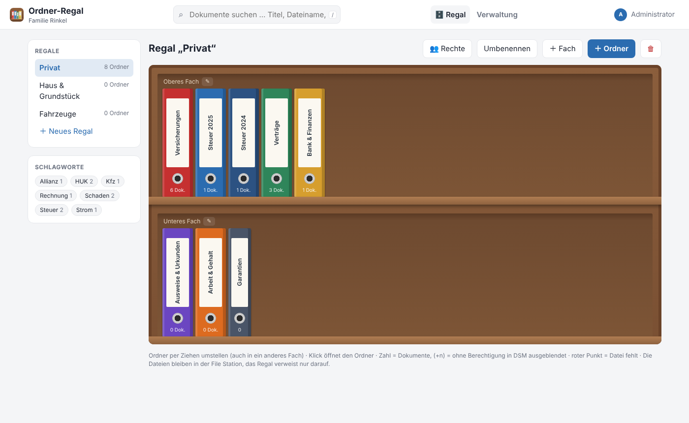
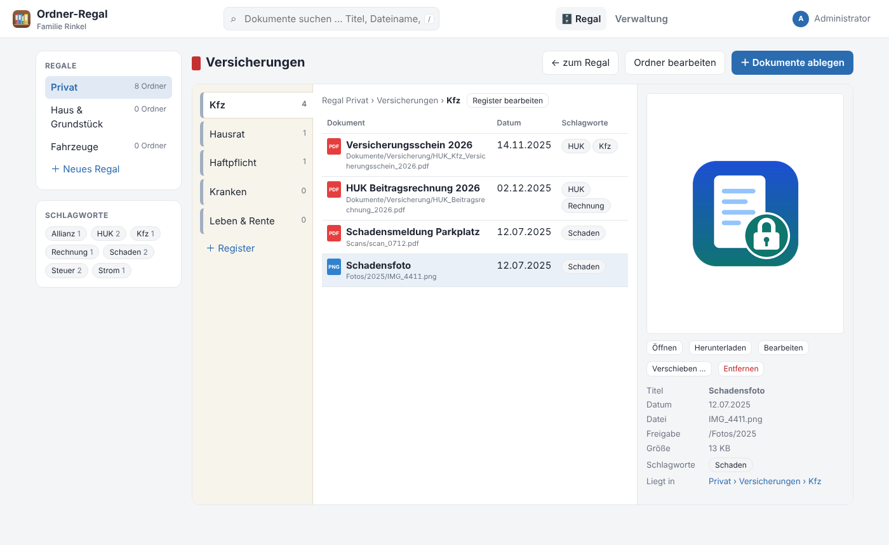
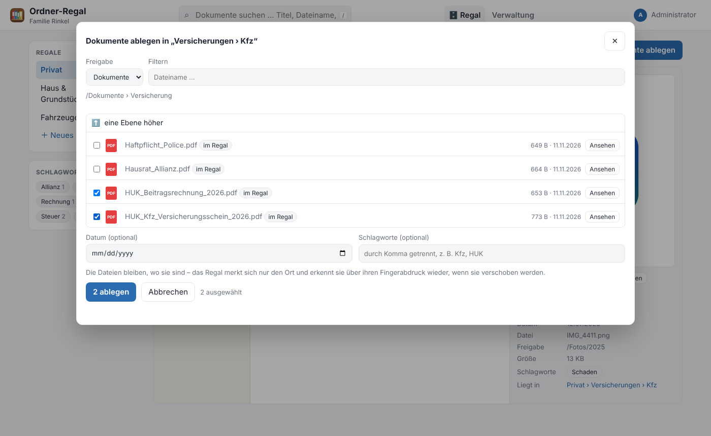
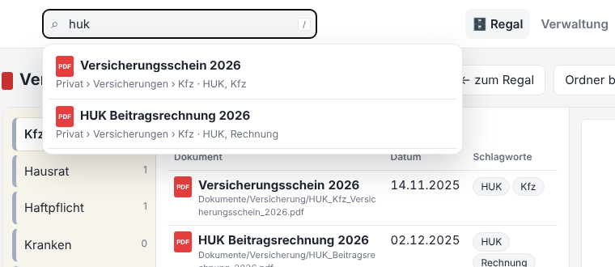
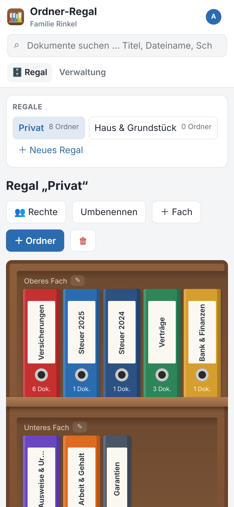
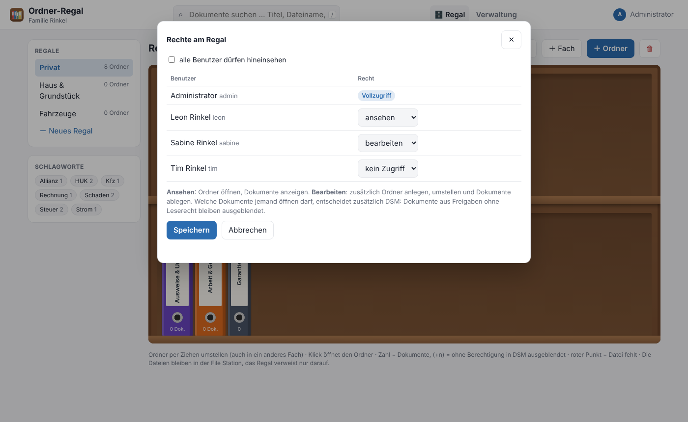
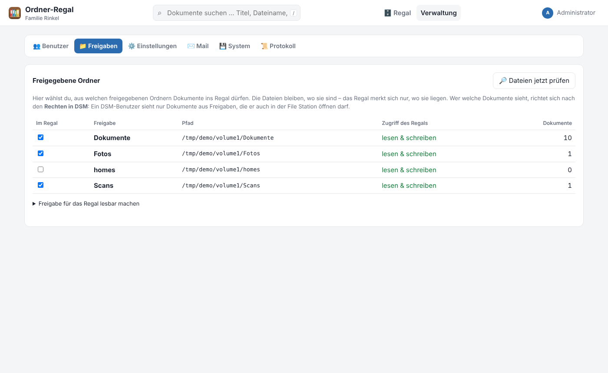

# Ordner-Regal für Synology

[](https://buymeacoffee.com/lapalutschi)

[](https://github.com/rinkelzz/ordner-regal/actions/workflows/ci.yml)
[](https://github.com/rinkelzz/ordner-regal/releases)
[](LICENSE)

Ein **virtuelles Ordner-Regal** für die Synology NAS: Regale mit Fächern, darin farbige Aktenordner mit Registern –
und in die Register legst du Dokumente aus deinen freigegebenen Ordnern. **Die Dateien bleiben, wo sie sind**; das
Regal merkt sich nur, wo sie liegen, und findet sie über ihren Fingerabdruck wieder, wenn sie verschoben werden.
Wer was sieht, richtet sich nach den **Rechten in DSM**. Für zu Hause (Versicherungen, Steuer, Verträge) und fürs
Büro (Ablage pro Kunde auf dessen NAS).

> **Stand 0.1:** Regale, Fächer, Ordner und Register, Dokumente aus Freigaben ablegen, Vorschau, Schlagworte, Suche,
> Rechte pro Regal und aus DSM, Wiederfinden verschobener Dateien – siehe [Fahrplan](#fahrplan).



## Inhalt

- [Funktionen](#funktionen)
- [Rechte](#rechte)
- [Fahrplan](#fahrplan)
- [Installation auf der Synology](#installation-auf-der-synology)
- [Freigaben einrichten](#freigaben-einrichten)
- [Updates über das Paket-Zentrum](#updates-über-das-paket-zentrum)
- [Datensicherung](#datensicherung)
- [Von unterwegs erreichbar machen (Reverse Proxy)](#von-unterwegs-erreichbar-machen-reverse-proxy)
- [Port ändern](#port-ändern)
- [Entwicklung](#entwicklung)

## Funktionen

### Regal

- **Regale** (z. B. „Privat“, „Haus & Grundstück“, „Praxis“) mit beliebig vielen **Fächern**.
- **Ordner** mit Rückenschild, Farbe und Breite (schmal, normal, breit) – per **Ziehen umstellen**, auch in ein
  anderes Fach. Ein roter Punkt am Rücken zeigt, wenn eine Datei fehlt.
- **Register** im Ordner (z. B. Kfz, Hausrat, Haftpflicht) mit eigener Farbe und Reihenfolge.
- **Dokumente ablegen:** Datei-Auswahl direkt aus den freigegebenen Ordnern (mit Filter, Vorschau und Hinweis
  „im Regal“), mehrere Dateien auf einmal, mit Datum und Schlagworten. PDF, Bilder, Text, Office – alles, was in einer
  Freigabe liegt.
- **Ein Dokument, mehrere Orte:** Die Rechnung kann in „Steuer 2025 › Belege“ **und** in „Garantien“ liegen.
  Verschieben oder zusätzlich ablegen per Dialog oder durch Ziehen auf ein Register (mit Strg/Alt: zusätzlich).
- **Vorschau** von PDF und Bildern direkt im Ordner, Öffnen in neuem Tab, Herunterladen.
- **Titel, Datum, Notiz und Schlagworte** pro Dokument – ändern nur die Ablage, nie die Datei.
- **Suche** in der Kopfzeile (Taste `/`) über Titel, Dateiname, Notiz und Schlagworte; Schlagwort-Wolke zum Filtern.
- **Wiederfinden:** Jede Nacht (oder per Knopf) prüft das Regal, ob die Dateien noch da sind. Verschobene oder
  umbenannte Dateien findet es in den eingeschalteten Freigaben über den SHA-256-Fingerabdruck wieder.

| Geöffneter Ordner | Dokumente ablegen |
|---|---|
|  |  |

| Suche | Am Handy |
|---|---|
|  |  |

### Plattform

- **Eigenes Fenster in DSM** mit Single Sign-on: DSM-Benutzer sind ohne weitere Anmeldung drin.
- **Anmeldung** mit eigenem Konto oder DSM-Konto (inklusive Zwei-Faktor-Code), Login-Sperre gegen Durchprobieren.
- **Name und Logo** in Kopfzeile und Anmeldung, vier Designs (Klassisch, Synology DSM, Dunkel, Warm & groß),
  für Handy und Desktop.
- **Nächtliche Datensicherung** in einen freigegebenen Ordner (für Hyper Backup), Wiederherstellen per Klick.
- **Updates über das Paket-Zentrum** – die App ist ihre eigene Paketquelle.
- **Änderungsprotokoll** aller wichtigen Aktionen, als CSV exportierbar.
- **Port** in der App änderbar, Mailversand über den eigenen SMTP-Server.

## Rechte

Zwei Ebenen, die beide passen müssen:

1. **Regal:** Benutzer mit **Vollzugriff** sehen und bearbeiten alle Regale und die Verwaltung. Alle anderen bekommen
   pro Regal **ansehen** oder **bearbeiten** (Ordner anlegen, umstellen, Dokumente ablegen) – oder ein Regal ist für
   alle sichtbar.
2. **Freigabe (wie in DSM):** Ein Dokument sieht nur, wer die Freigabe, in der die Datei liegt, auch in DSM lesen darf.
   Bei DSM-Benutzern übernimmt das Regal die Rechte bei jeder Anmeldung aus DSM (im DSM-Fenster bei jedem Öffnen,
   beim Login mit DSM-Passwort am Handy bei der Anmeldung). Dokumente ohne Berechtigung bleiben ausgeblendet – der
   Ordner zeigt nur „+n ausgeblendet“. Für **eigene Konten** ohne DSM hakt der Admin die Freigaben pro Benutzer an.



Grenzen in 0.1: Das Regal prüft die Rechte **pro Freigabe**, nicht pro Unterordner. Wer in DSM einzelne Unterordner
einer Freigabe sperrt, sollte für solche Dokumente eine eigene Freigabe nehmen. Die Freigabe `homes` (persönliche
Ordner aller Benutzer) ist deshalb ausgeschlossen.

## Fahrplan

| Version | Inhalt | Stand |
|---|---|---|
| **0.1** | Regale, Fächer, Ordner, Register, Ablegen aus Freigaben, Vorschau, Schlagworte, Suche, Rechte aus DSM, Wiederfinden | ✅ |
| **0.2** | **Scanner-Eingang:** Ordner (z. B. `Scans/Eingang`) überwachen, Eingangsfach im Regal, Einsortieren per Ziehen auf den Ordnerrücken – die Datei wird dabei in den **Zielordner** des Regal-Ordners verschoben | geplant |
| **0.3** | **Volltextsuche** in PDFs (Text mit pypdf, Index in SQLite FTS5) | geplant |
| **0.4** | **Fristen & Wiedervorlage** (Kündigungsfrist, Ablaufdatum) mit Mail-Erinnerung, Fristen-Übersicht | geplant |

## Installation auf der Synology

Voraussetzung: DSM 7. Ein Paket für alle Modelle – **Intel/AMD** und **ARM** (ARMv8, ARMv7).

1. Unter [Releases](https://github.com/rinkelzz/ordner-regal/releases) die neueste
   `ordnerregal-<version>-0001-noarch.spk` herunterladen.
2. DSM → **Paket-Zentrum** → **Manuelle Installation** → SPK auswählen → Hinweis zu Drittanbieter-Paketen bestätigen.
3. Im Assistenten eingeben:
   - ein Passwort für den Benutzer `admin` (mindestens 8 Zeichen),
   - optional einen **Namen** für die Kopfzeile (z. B. „Familie Rinkel“ oder den Firmennamen),
   - den **Port** (Standard `8790` – nur ändern, wenn er schon belegt ist).
4. „Ordner-Regal“ erscheint im DSM-Hauptmenü.

Das Paket nutzt das Python der NAS (3.8 bis 3.13). Fehlt es, bricht die Installation mit einem Hinweis ab –
dann im Paket-Zentrum „Python 3.9“ installieren. Die Daten liegen unter `/var/packages/ordnerregal/var/` und
bleiben bei Updates erhalten. **Beim Deinstallieren werden sie gelöscht** – deshalb die
[Datensicherung](#datensicherung) einrichten.

## Freigaben einrichten

Das Paket läuft unter DSM 7 als eigener Benutzer `ordnerregal` und sieht zunächst keine Freigaben. Für jede Freigabe,
aus der Dokumente ins Regal sollen:

1. **Systemsteuerung → Freigegebener Ordner** → Ordner auswählen → **Bearbeiten → Berechtigungen**.
2. Oben links im Auswahlfeld **System-interner Benutzer** wählen → bei `ordnerregal` **Lesen/Schreiben** setzen
   (für 0.1 reicht Lesen; ab 0.2 braucht das Einsortieren aus dem Scanner-Eingang Schreibrechte).
3. In der App unter **Verwaltung → Freigaben** die Freigabe einschalten.



Danach entscheidet DSM, welche Benutzer die Dokumente sehen (siehe [Rechte](#rechte)).

## Updates über das Paket-Zentrum

Die App ist ihre eigene Paketquelle – neue Releases von GitHub erscheinen im Paket-Zentrum zum Aktualisieren.
Einmalig einrichten:

1. **Paket-Zentrum → Einstellungen → Allgemein → Vertrauensebene:** „Beliebiger Herausgeber“
   (das Paket ist nicht von Synology signiert).
2. **Paket-Zentrum → Einstellungen → Paketquellen → Hinzufügen:** Name `Ordner-Regal`,
   Ort `http://127.0.0.1:8790/spk` (bei geändertem Port entsprechend – die genaue Adresse steht in der App
   unter **Verwaltung → System → Updates**).

Die App prüft etwa alle 30 Minuten (oder per „Jetzt prüfen“), lädt eine neue SPK auf die NAS und bietet sie dort an.
Die Paketquelle antwortet nur im lokalen Netz.

## Datensicherung

Die App sichert ihre Datenbank (Regale, Ordner, Register, Verweise, Schlagworte – **nicht die Dokumente selbst**,
die sichert Hyper Backup mit den Freigaben) jede Nacht (Standard 2 Uhr) in den Paketordner. Weil DSM diesen Ordner beim
Deinstallieren löscht und Hyper Backup ihn nicht erfasst, gehört zusätzlich ein **freigegebener Ordner** dazu:

1. **Systemsteuerung → Freigegebener Ordner** → z. B. `backup` → **Bearbeiten → Berechtigungen** →
   oben **System-interner Benutzer** wählen → `ordnerregal` **Lesen/Schreiben** geben.
2. In der App unter **Verwaltung → System → Datensicherung** den Ordner eintragen, z. B.
   `/volume1/backup/ordnerregal` (die App prüft die Schreibrechte), und die Aufbewahrung in Tagen festlegen.
3. Den freigegebenen Ordner in Hyper Backup aufnehmen.

Sicherungen lassen sich dort auch von Hand erstellen, herunterladen, wiederherstellen und löschen (die neueste ist
geschützt); vor dem Wiederherstellen wird der aktuelle Stand automatisch gesichert. Das **Mail-Passwort wird nicht
mitgesichert**. Den Ordner bitte **nicht für alle freigeben**.

## Von unterwegs erreichbar machen (Reverse Proxy)

Die Weboberfläche gibt es standardmäßig nur im DSM-Fenster und über **https** – unverschlüsseltes `http://NAS:8790`
aus dem Netz zeigt eine Hinweisseite (die Paketquelle funktioniert trotzdem). Wer im eigenen LAN doch über
http arbeiten will: Verwaltung → System → Zugriff.

Für den Zugriff von außen braucht die App eine eigene https-Adresse, z. B. `https://regal.meinedomain.de`:

1. DNS-Eintrag für die Subdomain auf die NAS zeigen lassen (z. B. CNAME auf die DDNS-Adresse).
2. **Systemsteuerung → Sicherheit → Zertifikat**: Let's-Encrypt-Zertifikat für die Subdomain.
3. **Systemsteuerung → Anmeldeportal → Erweitert → Reverse Proxy**: Quelle `HTTPS regal.meinedomain.de:443`,
   Ziel `HTTP localhost:8790`.
4. In der App unter **Verwaltung → Einstellungen → Öffentliche Adresse** genau diese Adresse eintragen.

**Eigener Proxy auf einem anderen Gerät** (z. B. Nginx Proxy Manager, auf den der Router 80/443 weiterleitet):
Proxy Host mit Ziel `http://<IP der NAS>:8790` und Let's-Encrypt-Zertifikat anlegen und unter
**Verwaltung → System → Eigener Reverse Proxy** die IP des Proxys eintragen – sonst sieht die App alle Zugriffe mit
dessen Adresse.

Für private Dokumente ist ein **VPN** zur NAS meist die bessere Wahl als eine öffentliche Adresse.
Den Port im Router **nie** direkt freigeben. Greift jemand per `http://` von außerhalb des Heimnetzes zu, zeigt die
App einen Warnhinweis.

## Port ändern

Unter **Verwaltung → System → Port** einen neuen Port eintragen (1025–65535, nicht von DSM belegt). Die App prüft,
ob er frei ist, speichert ihn in `/var/packages/ordnerregal/var/config.env` und startet sich selbst neu.
Im DSM-Fenster geht es danach einfach weiter. Anpassen musst du nur, was du selbst eingerichtet hast:
die **Paketquelle** im Paket-Zentrum und das **Ziel im Reverse Proxy**.

## Entwicklung

```bash
pip install -r requirements-dev.txt
pytest -q                                    # alle Tests
ORG_DATA_DIR=./data ORG_SHARE_ROOTS=/pfad/zu/testvolume python -m app.main   # http://localhost:8790
```

Beim ersten Start ohne `ORG_ADMIN_PASSWORD` steht das Admin-Passwort in `data/ERSTES_ADMIN_PASSWORT.txt`.
Die SPK baut `./synology/build_spk.sh` (lädt die Abhängigkeiten für Python 3.8–3.13 und alle Prozessoren von PyPI).

- **Technik:** Python + FastAPI + SQLite, statisches HTML/CSS/JS ohne Build-Schritt, keine nativen Bibliotheken.
  Das Fundament (Anmeldung, DSM-Fenster, Sicherung, Updates) stammt aus [IT-Dokumentation](https://github.com/rinkelzz/it-doku) (MIT).
- **Datenbank-Migrationen** über `PRAGMA user_version` in `app/db.py`: Neue Tabellen und Spalten kommen immer als
  neuer, nummerierter Schritt dazu; jeder Schritt läuft in einer eigenen Transaktion. 
- **Tests** laufen bei jedem Push auf Python 3.8 und 3.13 (GitHub Actions „Tests“).
- **Release:** Version in `app/__init__.py` und `CHANGELOG.md` eintragen, pushen, dann
  **Actions → Release → Run workflow** – baut die SPK und legt das GitHub-Release an.

## Lizenz

[MIT](LICENSE) – frei nutzbar, auch kommerziell. Gefällt dir die App? [Spendier mir einen Kaffee ☕](https://buymeacoffee.com/lapalutschi)

## English

**Ordner-Regal** ("binder shelf") is a self-hosted virtual filing shelf for Synology NAS (DSM 7): shelves with boards,
coloured binders with tabs, and in the tabs you file documents from your shared folders. Files stay where they are – the
shelf only stores references and re-finds moved or renamed files by their SHA-256 fingerprint. Visibility follows DSM
permissions: users only see documents from shared folders they can read in DSM (taken over on every DSM login / SSO).
The user interface is German.

- One noarch package for Intel/AMD and ARM, no native libraries; uses the NAS's Python 3.8–3.13.
- 0.1: shelves, boards, binders (drag & drop), tabs, filing from shared folders with a file picker, PDF/image preview,
  tags, search, per-shelf rights plus DSM share permissions, nightly file check and relinking, DSM window with single
  sign-on, nightly backups, updates through Package Center, audit log.
- Planned: 0.2 scanner inbox (watch a folder, file by dragging onto a binder, move the file into the binder's target
  folder), 0.3 full-text search in PDFs, 0.4 deadlines and follow-ups with e-mail reminders.

Install: download the `.spk` from [Releases](https://github.com/rinkelzz/ordner-regal/releases) →
Package Center → Manual Install, then grant the system user `ordnerregal` access to your shared folders.
Security notes: [SECURITY.md](SECURITY.md). License: MIT.

Like it? [Buy me a coffee ☕](https://buymeacoffee.com/lapalutschi)
